# Floorcount

The salsa count lights up on your own floor, so you stop walking back to the video.

A practice Lens for SPECS, built for Learn AR with SPECS (Devpost Learn, with Snap's CLAD) in November 2026. It's for salsa learners practising alone between classes: the hours when a tutorial on a phone is the only teacher in the room.

**Demo video (2:58):** https://www.youtube.com/watch?v=n4pGnXYn0ys
**Write-up:** [Floorcount: salsa steps on your floor](https://jonathanandrei.com/blog/floorcount-salsa-steps-on-your-floor-specs-lens/)

[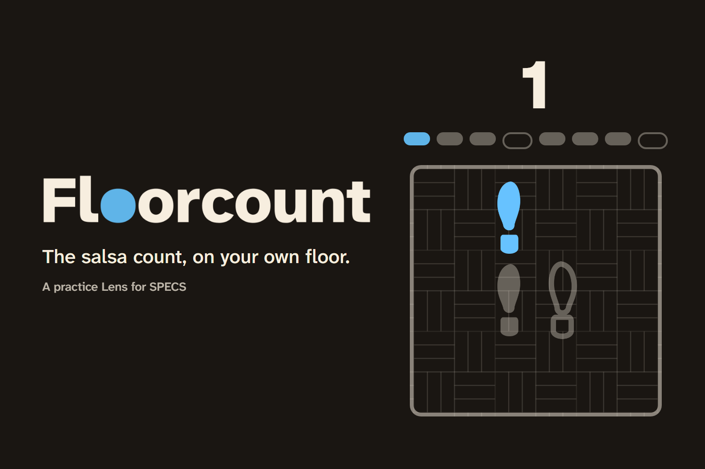](https://www.youtube.com/watch?v=n4pGnXYn0ys)

| | |
|---|---|
| 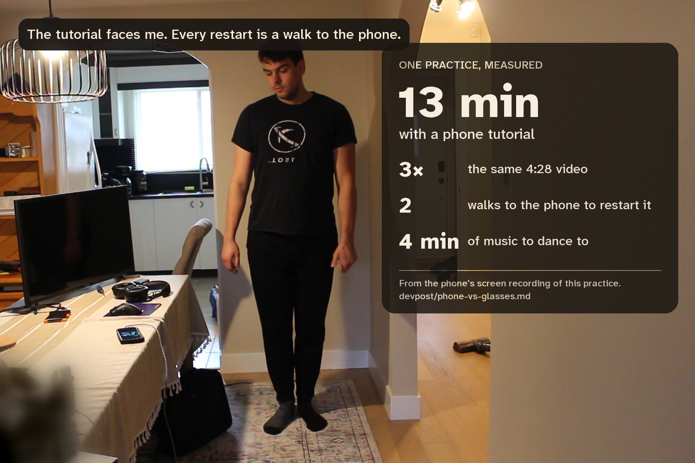 | 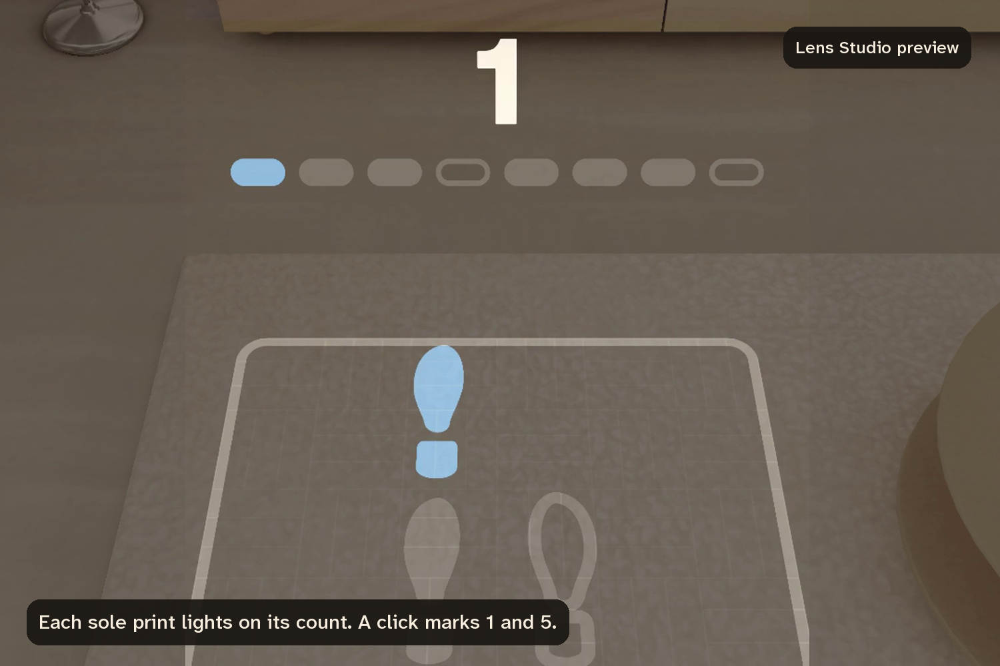 |
| The problem, measured: one practice with a phone tutorial. | Each print lights on its count; the holds on 4 and 8 stay dark. |
| 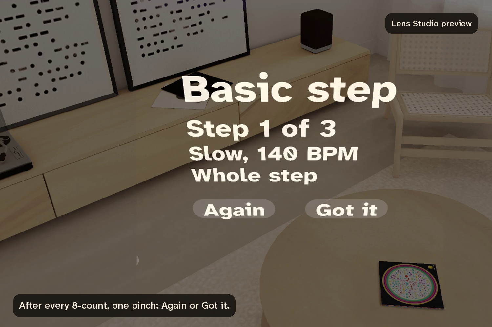 | 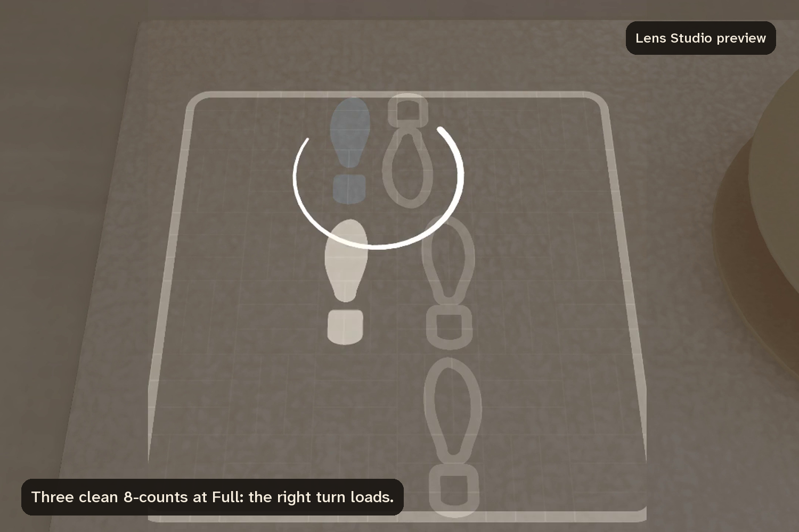 |
| After every 8-count, one pinch: Again or Got it. | Three clean 8-counts at Full and the right turn loads. |
| 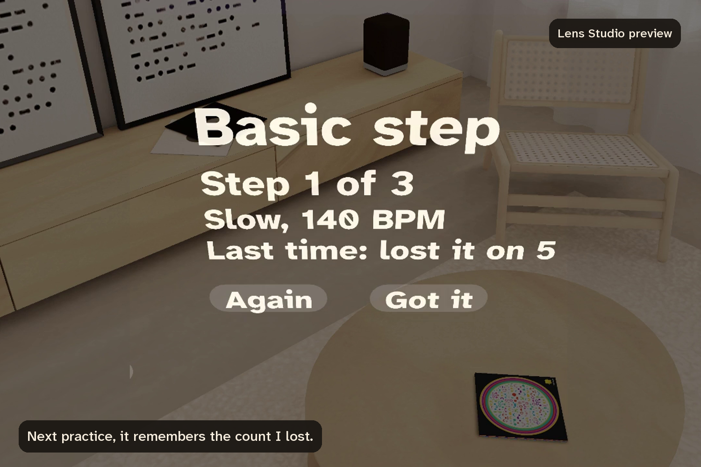 | 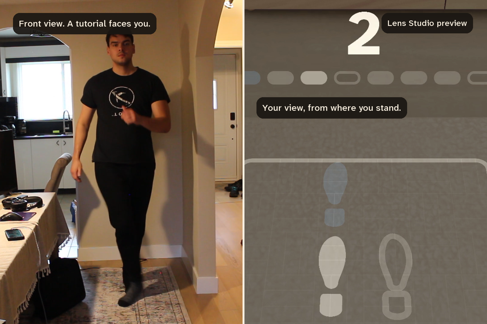 |
| Next practice, it remembers the count you lost. | A tutorial faces you; this is the step from where you stand. |

Every Lens image here is Lens Studio's preview. [How it was made](devpost/preview/8-how-it-was-made.png): six done criteria, 1095 Lens Studio MCP calls over 28 CLAD sessions, 18 LEAF scenarios, 84 unit tests.

## How to run it

You need Lens Studio 5.23.2, the version it was built in. No SPECS device, no Git LFS and no install step: everything runs in Lens Studio's preview.

1. Get the project. Either clone it or use GitHub's Download ZIP.
   ```
   git clone https://github.com/JonathanSolvesProblems/floorcount.git
   ```
2. Open `ARSpec.esproj` in Lens Studio. It asks once whether to trust a plugin, in a dialog titled "Loading Icon Atlas". That is an editor plugin from Snap's Icons package and the Lens does not use it, so either button works (I pressed **Block** in the [fresh-clone test](devpost/clean-clone-test.md)). Nothing loads until you answer. The first open then imports the assets and compiles the TypeScript, which takes a few minutes.
3. In the Preview panel, pick the SPECS device and switch to Interactive Preview.
4. Move with W A S D, Q and E for down and up, and right-drag to look. A click is a pinch.
5. Look down. The pad is on the floor 70 cm in front of where the preview started, with the basic step's prints lighting on their counts.
6. Turn right to the step card. After an 8-count has played, click **Again** or **Got it**. The Lens takes one answer per 8-count.
7. Click a print to mark the count you lost. Click the step name to pause.

To run it on a pair of Specs, pair the glasses with Lens Studio and send the Lens to them from the Preview panel; the project needs no change for that. I have not had a pair to try it on, so the preview is where it has been tested.

To run the tests, open the LEAF panel and run all scenarios. Start them on a freshly refreshed preview: five of them time themselves against the clock (c2, c5, c8, c9, c13), and the preview slows down the longer it has been running.

## The moment

I practise salsa alone at home. The tutorial is on my phone. It faces me, so every step is mirrored; I lose the count, walk over, scrub back, and start again.

Floorcount puts the count where my feet go. A 90 cm square sits on the floor with the step's sole prints on it at real size, and each one lights on its count. A clave-stick click marks 1 and 5 from the floor, the two counts a teacher calls to the class, and not the clave's own syncopated pattern, which is what beginners lose the count to. Robin Campbell, who runs the online salsa school The Dance Dojo, calls hearing where the 1 falls "the single biggest hurdle new dancers face" ([The Dance Dojo, 2026](https://thedancedojo.com/blog/how-salsa-music-is-counted/)). Above the far edge there is one large numeral and a strip of eight cells that shows where in the phrase I am. A Got it hides the numeral and the strip and an Again brings them back, because the aim is dancing eyes up, to the music.

## What it does

- Three steps from my own practice list: the basic, the right turn and the left turn (On1, leader's part).
- After each 8-count, two targets at hip height: **Again** or **Got it**. Two Agains in a row slow the music one level and show only counts 1 to 4 until I get them, then 5 to 8, then the whole step. Three clean 8-counts at Full tempo move to the next step.
- Pinch the print for the count I lost, and it takes a ring.
- At the end, the step with the most Agains comes back once, if there were any. Then the floor clears and the card lists each step's Agains. On a first practice each row also names the counts I lost; after that it shows last time's Agains.
- The Lens keeps my last practice. Next time, the counts I lost carry a fainter ring, the card reads "Last time: lost it on 2 and 5" until I answer, and the end card puts each step's Agains beside last time's.
- Look away from both the pad and the card, and a small arrow at the bottom of the view points back to the floor. The clave keeps going.
- The glasses see the floor. The pad is placed 150 cm below the eye to begin with, and once three depth readings under it agree, the whole layout settles onto the real floor, card included. A reading of a wall, or of a sofa seat 45 cm up, is refused.
- The practice music is generated at 140, 170 and 190 BPM, each loop exactly four 8-counts long, so there is no licensed track.

The Lens does not watch my feet and there is no machine learning in it. Again and Got it are my own report, and a fixed rule in [`FloorcountState.ts`](Assets/Scripts/FloorcountState.ts) decides what comes next.

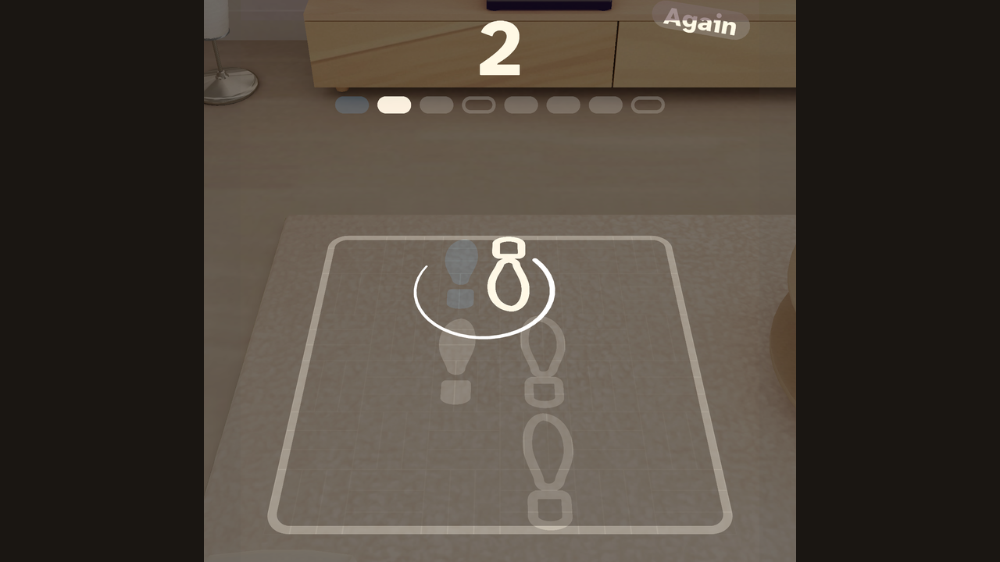

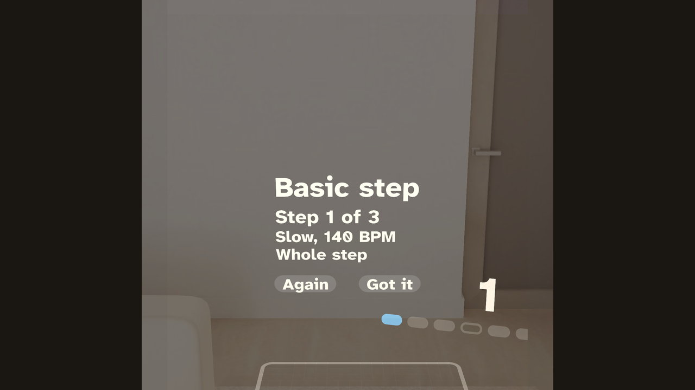

## The view from where you stand

Dancing uses the whole body, so a phone has nowhere to go. It sits on a shelf facing me and I walk back to it. The glasses put the step on the floor from where I stand, at real size, facing the way I face, with both hands free.

I measured one of my own phone practices for the video, with the phone's screen recorded and a camera on the room: 13 minutes with a 4:28 right-turn tutorial, played three times through, two walks to the phone to restart it, and 4 minutes of music to dance to. The other 8 and a half minutes were the instructor talking, watched three times over. The timestamps and the method are in [devpost/phone-vs-glasses.md](devpost/phone-vs-glasses.md).

Where you watch from matters. A preregistered study in PLOS ONE had 32 dancers learn a choreography from video in three views. The view from behind the dancer, which is the learner's own view, beat both front views, mirrored or not, and helped the less trained dancers most ([Versace et al., 2026](https://doi.org/10.1371/journal.pone.0355860)). A tutorial facing you is a front view. The pad is the view from where you stand.

## What's new about it

Footprints on the floor are a hundred years old. Arthur Murray [sold them by mail](https://www.fundinguniverse.com/company-histories/arthur-murray-international-inc-history/) from about 1920: numbered paper prints you laid out at home. In 2017 an iPhone app, [Dance Reality](https://www.uploadvr.com/arkit-app-uses-virtual-footsteps-show-dance/), drew animated footprints on the floor through the phone's camera (I know it from its 2017 launch coverage; its App Store page is gone now, and I have not used it). Paper cannot keep time, and a phone has to be held up between your eyes and your feet while you dance.

Floorcount is worn, so the prints are on the floor and nothing is in my hands. It also counts the way salsa is counted: on 4 and 8 no print lights and the cell stays an outline.

It changes with how I'm doing. Two Agains slow the music (unless it is already at Slow) and cut the step in half, and three clean 8-counts at full tempo move on. A Got it hides the numeral and the strip, because the goal is dancing to the music with my eyes up, not following lights.

## How it was planned and built

1. **Planned with the Devpost Learn skill pack.** The `plan-lens` interview wrote [devpost/design-brief.md](devpost/design-brief.md): one spatial moment, where each thing lives, how the hands act on it, and six done criteria that can be checked in the preview.
2. **Built by CLAD through the Lens Studio MCP.** Snap's `specs-experience-builder` agent built the scene in Lens Studio 5.23.2 from the brief. Spectacles Interaction Kit handles every pinch, `build-music` and `build-sfx` generated the audio, the sound plays spatially from the pad, and the Editor API saves the project at each milestone.

   Twenty-eight CLAD sessions made 1095 Lens Studio MCP calls: [devpost/BUILD_LOG.md](devpost/BUILD_LOG.md) counts them from the sessions' own transcripts, and [devpost/PROMPTS.md](devpost/PROMPTS.md) holds every prompt, word for word. The account of the build is in [devpost/build-report.md](devpost/build-report.md), including the beat clock CLAD had to rewrite: the preview reports a stale audio position for about a second after play, and the first version read that as the loop wrapping and ran the count at up to 620 BPM against a 140 BPM track.
3. **Tested twice over.** LEAF scenarios run the Lens in the preview, one per done criterion and then more for what the criteria leave out. Unit tests run the session rules and the footwork data with no Lens Studio at all, on every push. See [Tests](#tests).
4. **Designed as its own thing.** The first build worked and looked like a default: cartoon feet in blue and orange, a frosted panel, stock icons. The look it has now comes from the clave, the pair of wooden sticks that keep time in salsa. The pad is laid out like its rhythm grid, each print is a struck note, and the light fades over one beat the way a struck clave rings out. On this display black is transparent and alpha is brightness, so there is one ivory ink at three brightnesses and one blue reserved for the 1. Left feet are solid and right feet are outlined, because a clave pair has two roles: one is held and the other strikes it. The laws are in [.design/brand/CHARTER.md](.design/brand/CHARTER.md), the sheet is [.design/brand/index.html](.design/brand/index.html), and what CLAD changed to apply them is in [devpost/design-pass-report.md](devpost/design-pass-report.md).

| First build | After the design pass |
|---|---|
| 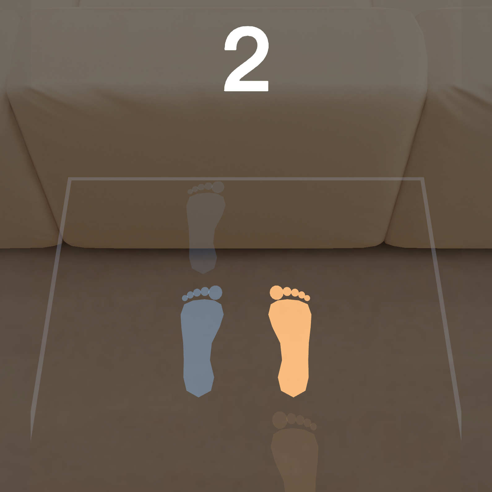 | 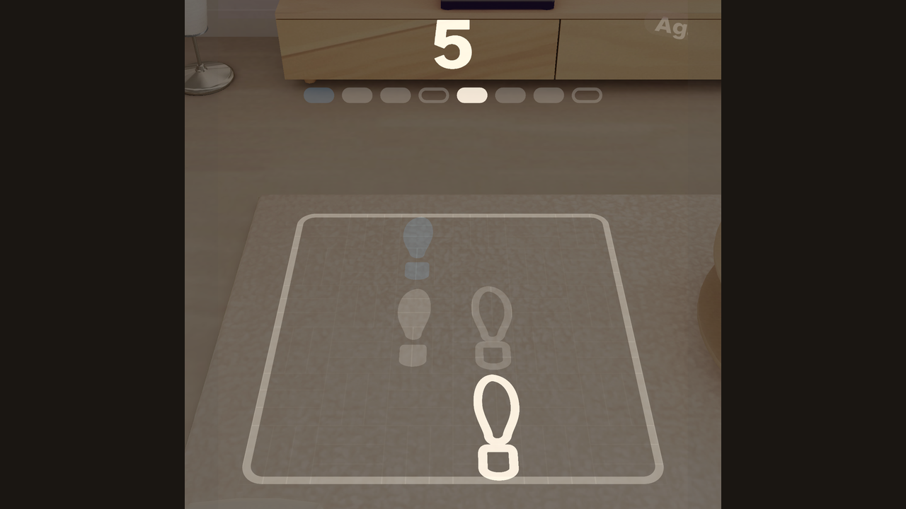 |

## Tests

Eighteen LEAF scenarios in [`Assets/Tests/`](Assets/Tests/), run in the preview on 6, 7 and 8 November 2026. All eighteen pass, also on a fresh clone of this repository.

| Scenario | What it checks |
|---|---|
| `floorcount-c1-start` | The pad is 70 cm ahead on the floor with the basic step's prints at real size, music at Slow. |
| `floorcount-c2-beat` | Each print lights on its count, nothing lights on 4 and 8, the display follows the count. |
| `floorcount-c3-again` | Two Agains in a row drop the tempo and show counts 1 to 4 only. |
| `floorcount-c4-next-step` | Three Got its at Full load the right turn, with its arc on the turn counts. |
| `floorcount-c5-mark-and-summary` | A pinched print is marked, the worst step replays once, the floor clears and the card lists the Agains. |
| `floorcount-c6-off-view-arrow` | The arrow shows only while neither the pad nor the card is in view. |
| `floorcount-c7-step-card` | The card's four lines share one left edge, the capsules fit their labels, and pausing says so in words. |
| `floorcount-c8-answer-guard` | One answer per 8-count, taken in its first four counts, none before the first 8-count has played and none while paused. |
| `floorcount-c9-session-memory` | A finished session comes back: a ring at rest brightness on the lost count, the focus line, and "last time" in the summary. |
| `floorcount-c10-left-turn` | The third step loads with its pivot print facing back and its arc on counts 6 and 7 only. |
| `floorcount-c11-halves` | After two Agains counts 1 to 4 are on the floor, then 5 to 8, then the whole step. |
| `floorcount-c12-count-display` | A Got it hides the numeral and the strip, an Again brings them back. |
| `floorcount-c13-the-and` | A print and its cell rise on the "and", strike on the count and decay, and a hold cell never rises above rest. |
| `floorcount-c14-mark-ring` | Pinching the prints for 2 and 5 leaves rings at 0.5, and the row ends "lost it on 2 and 5". |
| `floorcount-c15-restart-from-summary` | Pinching the title in the summary goes back to step 1 at Slow, with the floor and the buttons. |
| `floorcount-c16-arc-inside-pad` | Measured in the running Lens, both turn arcs stay inside the border: 35.7 and 35.2 cm from the centre against an inner edge at 43.2. |
| `floorcount-c17-teal-law` | Across all three steps, the only blue in the scene is the count 1 print and cell 1. |
| `floorcount-c18-floor-settle` | The rule that settles the layout onto the real floor, with the readings fed by hand because the preview has no depth: a wall is ignored, three agreeing readings move the pad and the card together, a sofa seat is refused, disagreeing readings wait, and a reset restores the fixed height. |

The first six are the brief's done criteria. The beat test, run on a fresh clone of this repository, sampled the Lens 130 times over 8 seconds and found no wrong print, nothing lit on a hold, and 140.4 BPM against the 140 BPM loop. How many samples it gets depends on how fast the preview is running that day; the result is the same.

Most scenarios press Again and Got it back to back to walk the rules, so they switch the one-answer-per-8-count guard off. Scenario 8 runs with it on, the way the Lens ships.

Two more scenarios are helpers, not tests: `floorcount-hold-on-count` and `floorcount-capture` hold the Lens on a frame so it can be photographed. The full results are in [devpost/design-pass-report.md](devpost/design-pass-report.md), section "Session memory and coverage", and the run on a fresh clone of this repository, with the beat test numbers quoted here, is in [devpost/clean-clone-test.md](devpost/clean-clone-test.md).

### Unit tests, without Lens Studio

The session rules ([`FloorcountState.ts`](Assets/Scripts/FloorcountState.ts)), the footwork data ([`FloorcountSteps.ts`](Assets/Scripts/FloorcountSteps.ts)) and the brightness curve ([`FloorcountLook.ts`](Assets/Scripts/FloorcountLook.ts)) are plain TypeScript, so they also run under Node. You need Node 22.

```
npm ci --prefix tests/unit
npm test --prefix tests/unit
npm run breaks --prefix tests/unit
node tests/check-repo.mjs
```

- `npm test`: 84 tests. They walk every rule of a session, check each step's prints against the footwork tables in the brief, hold the brightness curve to the charter (rest at 35%, the "and", the half beat before a count, at 60%, the strike at 100%, a hold never lit), and check the floor rule (three readings that agree, a sofa seat refused, a wall ignored).
- `npm run breaks`: plants 61 bugs in those four files, one at a time, and reruns the tests against each. A planted bug the tests miss fails the run. All 61 are caught.
- `check-repo.mjs`: no tracked binary is a Git LFS pointer, every LEAF scenario is registered, no tracked file carries a local path, and no string the Lens shows breaks the voice rules.

GitHub Actions runs the same three checks on every push ([`.github/workflows/checks.yml`](.github/workflows/checks.yml)). The LEAF scenarios need Lens Studio's preview, so they run there and not in CI.

A unit test found both turn arcs running 5 cm past the pad's edge, which the eight preview scenarios that existed then had passed over.

## Where the build differs from the brief

The brief marked every value I had not chosen myself as a default, and the design pass changed some of them. The done criteria and the sizes of the pad and prints stand.

- Footprints were to be blue for the left foot and orange for the right. They are solid and outlined in one ivory, with blue on count 1.
- The count display was to be one number. It is a numeral above a strip of eight cells, and both are blank on 4 and 8 because a hold is a rest.
- Pinching Again or Got it "after an 8-count" is now enforced: one answer per 8-count.
- The step card was to be a UI Kit panel. It is text on the air with two capsule targets, because a panel floating in front of the face is what the event's own design rules warn against.
- The pad was to hang off the start position at a fixed height. It now settles onto the floor the glasses see.

## Limits

- Everything here ran in Lens Studio's preview. No SPECS device was used, so comfort over a real session, real hand tracking, and the hand-over from looking down at the pad to dancing eyes up are unproven.
- The pad starts 150 cm below the eye and settles onto the floor the glasses see through the WorldQueryModule depth, once three readings under it agree. The preview has no depth to read, so there it keeps the fixed height, and the settle has only ever run on readings a scenario fed by hand.
- A pad 70 cm ahead on the floor is about 65 degrees below a level gaze and the glasses see about 37 by 32 degrees, so the pad, the count and the card are never all in view at once. The arrow is what brings me back.
- Leader's part and On1 only, three steps, no partner work.

## Repository

- `Assets/`: the Lens. Scripts, scene, materials, textures, generated audio, and the LEAF scenarios.
- `Packages/`: Snap's Spectacles Interaction Kit 2.0, UI Kit 2.0 and LEAF 2.0.2, plus the Icons, Motion and Bitmoji 3D packages that came with the template, as installed.
- `devpost/`: the planning brief from the skill pack, the build log and every prompt, the build report, the design notes and the report on applying them, the fresh-clone test, the submission text, and screenshots.
- `.design/`: the brand kit (sheet, charter, voice, manifest, textures, fonts, video cards) and the photos and notes it came from.
- `tests/`: the unit tests, the planted-breaks run and the repository checks. `.github/workflows/checks.yml` runs all three on every push.
- `tempAssetGen/`: the two scripts CLAD wrote to generate the music and the sound effects.
- `DEMO_SCRIPT.md`: the shot list for the video.

## Credits and licences

The Floorcount code, tests, audio, textures and documents are under the [MIT licence](LICENSE). The packages in `Packages/` are Snap's and stay under their own terms. The typeface is Atkinson Hyperlegible Next by the Braille Institute, under the SIL Open Font License. The three photos on the brand sheet are adapted from Wikimedia Commons under CC BY-SA 4.0 and credited in [.design/refs/credits.json](.design/refs/credits.json).

The demo video's music is ["Salsa Island"](https://www.fesliyanstudios.com/royalty-free-music/download/salsa-island/735) by Steve Oxen, music used from [https://www.FesliyanStudios.com](https://www.fesliyanstudios.com/), an instrumental, under their [free-use policy](https://www.fesliyanstudios.com/policy) for videos that are not monetised. It is in the video only; the Lens plays its own generated music.
